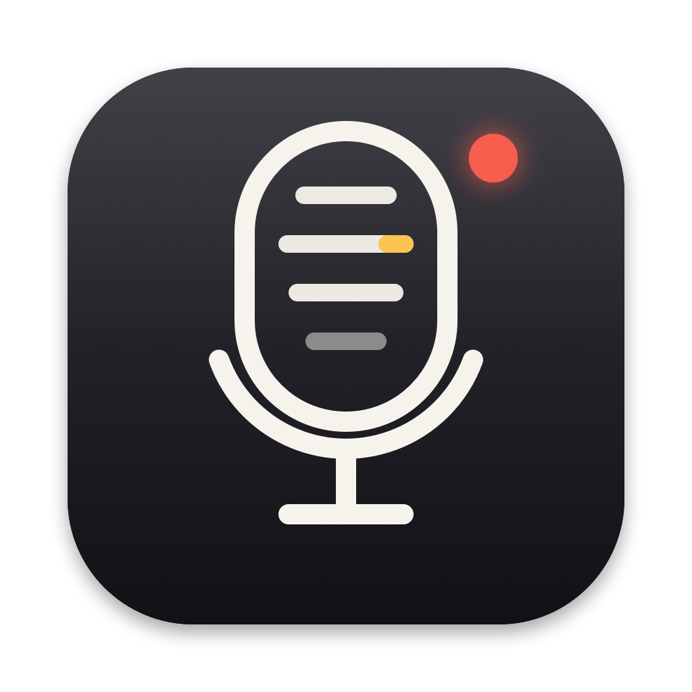
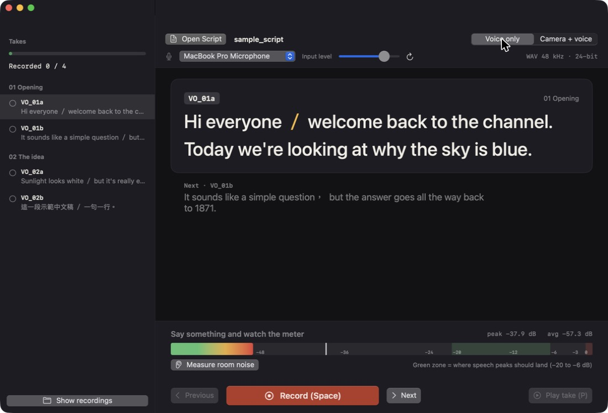

<p align="center"></p>

<h1 align="center">NarrationBooth</h1>

A teleprompter recorder for Mac, made for voice-over and talking-head videos (explainers, tutorials, travel vlogs).
Open your script, read it one sentence at a time (or a block, or all of it in one go), and NarrationBooth joins the takes
into clean, studio-quality files that are ready to edit.



## Why

Recording narration with a phone voice memo works, until you edit it: one long file, a 16 kHz compressed format,
stray pauses, retakes buried in the middle, and no way of knowing your level until it's too late.
NarrationBooth records the way editors want it:

- **Record a sentence at a time, get one file per block.** Stop after every sentence (or record a whole block, or the whole script) and the takes are trimmed and joined automatically into `VO_01a.wav`, `VO_01b.wav`… plus `<script>_full.wav`.
- **Studio format.** WAV, 48 kHz, 24-bit, mono, with no processing, no auto-gain and no noise suppression. You get exactly what the mic hears.
- **Camera mode.** Record yourself on camera while reading. Each take also saves `VO_01a.mov` (HEVC, 4K when the camera supports it, 1080p otherwise), starting together with the WAV.
- **Teleprompter.** Big text, the current sentence highlighted, breath marks (`／`) coloured, the next line shown underneath.
- **Eye contact in camera mode.** The window goes full screen and the script becomes a narrow, centred column right under the built-in camera, so reading looks like looking into the lens. (If you keep the window smaller, the text still shifts toward the camera.)
- **Level meter that tells you what to do.** "Too quiet: move closer", "Clipping! Lower the input level". A green zone shows where speech peaks should land (−20 to −6 dBFS).
- **Room-noise check.** Three seconds of silence tells you whether the room is quiet enough.
- **Mic picker and input level**, including USB / audio-interface mics and an iPhone used as a Continuity mic or camera.
- **Retakes never destroy anything.** Re-record a sentence and the old take moves to `_old_takes/`.
- **Resumable.** Close the app and open the same script later; it picks up at the first take you haven't recorded.

## Download

1. Download **NarrationBooth-x.y.z.zip** from [Releases](https://github.com/nashwu0117/NarrationBooth/releases/latest).
2. Double-click the ZIP (Safari usually unzips it for you) and drag **NarrationBooth** into your **Applications** folder.
3. **First launch (one time):** NarrationBooth isn't signed with an Apple developer certificate, so macOS blocks it the
   first time.
   - Open NarrationBooth from Applications. macOS says it can't be opened; click **Done**.
   - Open **System Settings → Privacy & Security**, scroll down to **Security**, and next to
     *"NarrationBooth" was blocked…* click **Open Anyway**. Confirm with your password, then click **Open Anyway** again.

   From then on it opens normally. Terminal alternative: `xattr -dr com.apple.quarantine /Applications/NarrationBooth.app`

> Why a ZIP and not a DMG? Recent macOS versions turn a DMG into an *Install this app?* dialog that refuses apps Apple
> hasn't notarized ("This Mac can't verify this app, so it wasn't installed"). Dragging the app out of a ZIP avoids it.

### Updates

NarrationBooth checks GitHub for a new release once a day (and from **NarrationBooth → Check for Updates…**).
When there is one, it shows what changed and a **Download** button; unzip the download and drag the app into
Applications to replace the old one. Your settings and recordings are kept.

## Requirements

- macOS 14 Sonoma or later, Apple silicon or Intel
- Xcode 16+ or the Swift 6 toolchain (only to build it)

## Build from source

```bash
git clone https://github.com/nashwu0117/NarrationBooth.git
cd NarrationBooth
Scripts/package_app.sh          # builds the app: NarrationBooth.app
open NarrationBooth.app
```

`INSTALL=1 Scripts/package_app.sh` also copies the app to `/Applications`.
Local builds are signed with your *Apple Development* identity when you have one (so macOS keeps the microphone
and camera permission across rebuilds), otherwise ad hoc.
The first launch asks for microphone (and, in camera mode, camera) access.

### Releasing (maintainers)

```bash
Scripts/release.sh 1.1.0 "What changed"   # bump version, build, zip, tag, push, publish the GitHub release
```

`Scripts/make_zip.sh` builds `dist/NarrationBooth-<version>.zip`. Release builds are signed ad hoc, so downloads
carry no personal certificate; users allow the app once under Privacy & Security (see *Download*).

## Writing a script

Plain `.txt` or `.md`. Each `VO_<name>` line starts a block (one block = one take = `VO_<name>.wav`), with one sentence
per line under it; ` / ` or `／` marks a breath, `##` lines are sections, `//` lines are notes.

**Full format: [docs/SCRIPT_FORMAT.md](docs/SCRIPT_FORMAT.md)** · Template: [examples/template.txt](examples/template.txt)
(also in the app: **Help → Save Script Template…**)

```text
## 01 Opening

VO_01a
Hi everyone / welcome back to the channel.
Today we're looking at why the sky is blue.

VO_01b
It sounds like a simple question / but the answer goes all the way back to 1871.
```

## Recording

### Take modes

Choose how much you record per take from the menu in the top bar or in **Settings (⌘,)**:

| Mode | How it works |
|---|---|
| **One sentence per take** (default) | Read a sentence, press Space to stop. Check it (P plays it, R re-records it), then Space moves to the next sentence and starts recording. A slip only costs that sentence. Click any sentence in the prompter to jump to it. |
| **One block per take** | Read a whole `VO_` block, press Space to stop and move to the next block. |
| **Whole script in one take** | Press Space once to start, then Space after each sentence to move the prompter on. The recording never stops; after the last sentence Space ends the take (Esc stops any time). |

When every take is done, NarrationBooth **combines them automatically** (or press **Combine**, ⌘J, at any time):
`VO_<name>.wav` for each block plus `<script>_full.wav` for the whole script, and the matching `.mov` files in camera
mode. The silence before and after each take is trimmed, and the gaps between sentences and blocks are real room tone
you recorded, never inserted silence, so audio and video share exactly the same cuts. Gap lengths and trimming are in Settings.

| Key | Action |
|---|---|
| Space | Record / stop; after checking a take, go to the next line and record it (whole-script mode: next sentence) |
| P | Play the take back |
| R | Re-record the take you just made |
| Esc | Stop the current take |
| ← → | Previous / next line (or click a line) |
| [ ] | Pacing guide slower / faster |
| ⌘J | Combine takes now |
| ⌘O | Open a script |
| ⇧⌘O | Choose the output folder |

### Pacing guide

Reading too fast is the most common narration mistake. While a take records, the line fills from grey to white at a
steady speaking pace, like karaoke lyrics: read where the white is and don't get ahead of it. Commas, full stops and
breath marks (`／`) hold for a moment. The default, 4.3 syllables a second (one Chinese character = one syllable), is a
relaxed, clear narration pace. Change it with the − / + next to the prompter, the `[` `]` keys, or in Settings, where the
guide can also be turned off. After each take NarrationBooth tells you whether you were on pace or how much faster you read.

### Where files go

Pick where recordings go with the **folder button** in the top bar (remembered between launches; default `~/Downloads`).
Each script gets its own folder:

```text
<output folder>/<script name>_recordings/
├── VO_01a.wav             combined block (WAV 48 kHz, 24-bit, mono, unprocessed)
├── VO_01a.mov             camera mode only
├── <script name>_full.wav the whole script joined
├── takes/                 raw takes: VO_01a_1.wav (sentence), VO_01a.wav (block) or FULL.wav (whole script)
├── _old_takes/            earlier takes of anything you re-recorded (never deleted)
└── session.json           length, peak level and clipping flag of each take
```

Tips: speak at your normal pace and keep peaks in the green zone. If you stumble, stop, press R and say it again; the earlier
take is kept in `_old_takes/`. A tap shorter than 0.3 s is ignored and never replaces a take. Don't want to stop and check
every take? Turn it off in Settings and Space goes straight on to the next line (it can also play each take back automatically).

## Microphones

Any mic macOS sees works: built-in, USB, audio interfaces, an iPhone (Continuity), Bluetooth. Mics that are connected
while the app is open show up right away, and the app remembers your choice. The format label in the top bar turns amber
when the selected mic delivers less than 44.1 kHz.

**Wireless clip-on mics (DJI Mic, RØDE Wireless, etc.): plug the receiver in, don't pair the transmitter over Bluetooth.**
Paired straight to a Mac, a transmitter runs as a Bluetooth headset: 16 kHz, phone quality, and some (DJI Mic Mini)
force their strongest noise cancellation on. Plug the receiver into the Mac's USB-C port instead, so it shows up as a
digital USB mic, and set gain on the receiver. For narration in a quiet room, turn the mic's own noise cancellation off:
the voice sounds fuller, and noise is easier to clean up in the edit.

**Safety track.** Receivers that send a second, 6 dB quieter copy of the voice (DJI Mic "safety track") are detected
automatically: NarrationBooth records the main channel only, and if a take clips, it saves that take from the safety
track instead. Two transmitters in stereo mode are mixed into the mono file.

## Language

The interface is in English. Traditional Chinese is available from the **Language** menu (relaunch to apply).

---

## 中文說明

給 Mac 用的提詞錄音工具，適合錄旁白和真人出鏡的知識型影片。打開稿子，一句一句（或一段一段、整份一次）唸，錄完自動接成可以直接剪的高音質檔案。

- **三種錄法**（上方選單或「設定」⌘, 切換）：
  - **一句一錄**（預設）：唸完一句按空白鍵停，先聽聽看（P 播放、R 重錄），沒問題再按空白鍵錄下一句。唸錯只要重錄那一句，點稿子上任何一句可以直接跳過去。不想每句都停下來聽，可以在設定關掉。
  - **一段一錄**：每個 `VO_` 段落錄一次。
  - **整份一次錄**：按一次開始，每唸完一句按空白鍵換下一句，錄音不中斷，最後一句再按一次結束（Esc 隨時可停）。
- **步調提示（防止唸太快）**：錄音時，這一句的字會照節奏從灰色慢慢變白，像卡拉 OK 字幕，白色到哪就唸到哪，不要超過它。逗號、句號、換氣記號「／」會停一下。預設每秒 4.3 字（輕鬆清楚的旁白速度），可以用提詞旁的 − ＋、鍵盤 [ ]，或在設定裡調整、關掉。每錄完一句會告訴你速度剛好，還是比建議快了多少。
- **全部錄完自動合併**：每段一個 `VO_01a.wav`，再加上整份的 `<稿子名>_full.wav`（鏡頭模式也會合併 `.mov`）。會修掉每次錄音前後多餘的空白，句子之間的間隔用的是你錄到的真實環境音，聲音和影片用同樣的剪點不會跑掉。也可以隨時按「合併」（⌘J）。原始錄音留在 `takes/` 資料夾。
- **錄音室規格**：WAV 48 kHz、24-bit、單聲道，不做任何處理（沒有自動增益、沒有降噪），錄到的就是麥克風聽到的。
- **鏡頭模式**：邊看稿邊對鏡頭講，同時錄 `VO_01a.mov`（HEVC，鏡頭支援就 4K，否則 1080p），和聲音檔同時開始。視窗會全螢幕，稿子縮成窄欄放在鏡頭正下方，唸稿時看起來就像在看鏡頭。
- **提詞**：大字、一句一行，「／」換氣記號用顏色標出來，下面預告下一段。
- **選存檔位置**：上方的資料夾按鈕可以選錄音存在哪裡，會記住你的選擇（預設是「下載」）。
- **會告訴你怎麼調的音量表**：「太小聲：靠近一點」「爆音了！調低輸入音量」，綠色區就是講話時峰值該停的位置。
- **測環境噪音**、**選麥克風／調輸入音量**（支援 USB 麥克風、錄音介面、iPhone 當麥克風或鏡頭）。
- **重錄不會蓋掉舊的**：舊的那次會移到 `_old_takes/`。
- **可以接著錄**：下次打開同一份稿子，會從還沒錄的那句開始。

**下載安裝**：
1. 到 [Releases](https://github.com/nashwu0117/NarrationBooth/releases/latest) 下載 `NarrationBooth-x.y.z.zip`。
2. 點兩下 ZIP 解壓縮（Safari 通常會自動解開），把 NarrationBooth 拖到「應用程式」資料夾。
3. **第一次打開（只要一次）**：這個 App 沒有用 Apple 開發者憑證簽章，所以 macOS 第一次會擋下來：
   - 從「應用程式」打開 NarrationBooth，出現「無法打開」時按「完成」。
   - 打開「系統設定 → 隱私權與安全性」，往下捲到「安全性」，在「已阻擋 NarrationBooth…」旁邊按**強制打開**，輸入密碼後再按一次**強制打開**。

   之後就能正常打開。（也可以在終端機執行 `xattr -dr com.apple.quarantine /Applications/NarrationBooth.app`）

> 為什麼是 ZIP 不是 DMG？新版 macOS 打開 DMG 會跳出「要安裝此 App 嗎？」，而那個安裝視窗會直接拒絕沒經過 Apple 公證的 App（「這部 Mac 無法驗證此 App，因此沒有安裝」）。用 ZIP 自己拖進「應用程式」就不會遇到。

**自動更新**：App 每天會檢查一次 GitHub 有沒有新版本（也可以從選單「Check for Updates…」手動檢查），有新版會顯示更新內容和下載按鈕，下載的 ZIP 解壓縮後一樣拖進「應用程式」取代舊版，設定和錄音都會保留。

**稿子格式**：見 [docs/SCRIPT_FORMAT.md](docs/SCRIPT_FORMAT.md)（有中文說明），範本在 [examples/template.txt](examples/template.txt)，App 選單 Help → Save Script Template… 也能存一份。

**麥克風**：內建、USB、錄音介面、iPhone、藍牙都可以。App 開著時才接上的麥克風會馬上出現在清單裡，也會記住你上次選的。麥克風低於 44.1 kHz 時，上方的格式標籤會變成橘色。

> **無線領夾麥（DJI Mic、RØDE Wireless 等）：把接收器插上 Mac，不要讓發射器直接用藍牙配對。** 發射器直接藍牙連 Mac 會被當成藍牙耳機，只有 16 kHz 的電話音質，DJI Mic Mini 還會強制開最強的降噪。把接收器插在 Mac 的 USB-C 孔，就是數位 USB 麥克風，增益在接收器上調。在安靜的房間錄旁白，建議把麥克風本身的降噪關掉，聲音比較飽滿，雜音後製再處理就好。
>
> **安全音軌（防爆音）**：接收器如果有開安全音軌（第二聲道是小 6 dB 的同一個聲音，例如 DJI Mic），App 會自動認出來，只錄主聲道；某一句爆音了，那一句就自動改用安全音軌存檔。兩個發射器的立體聲模式則會混成單聲道。

介面預設英文，可以從選單「Language → 繁體中文」切換。

## License

[MIT](LICENSE) © 2026 Nash Wu
